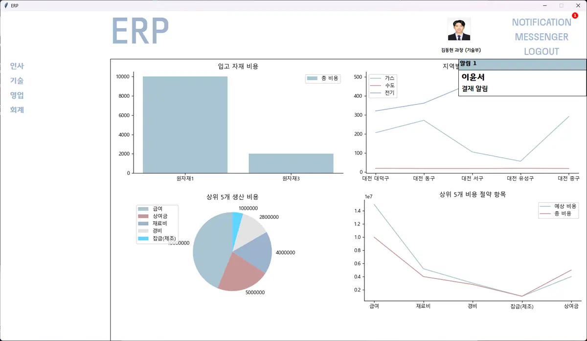
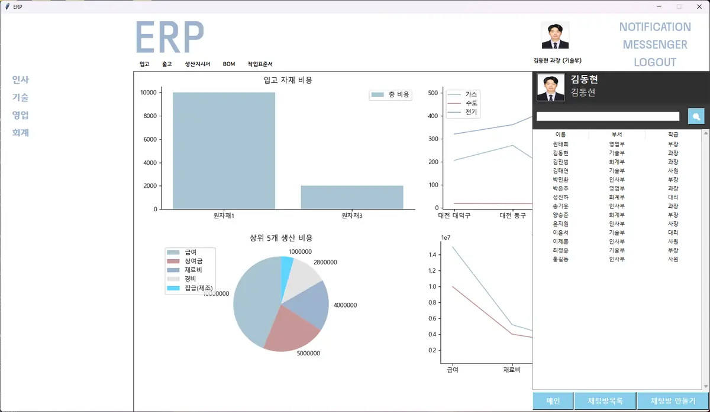
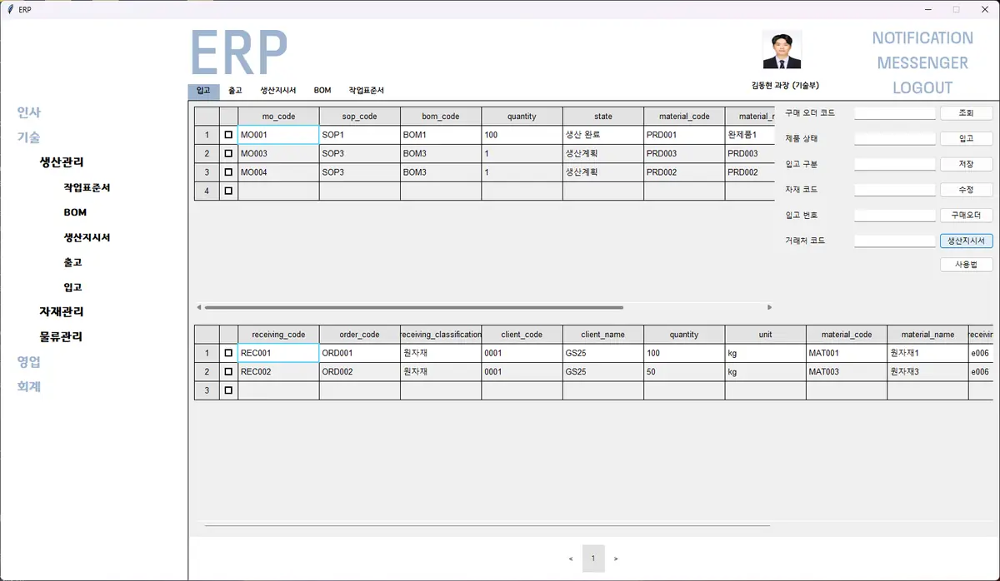
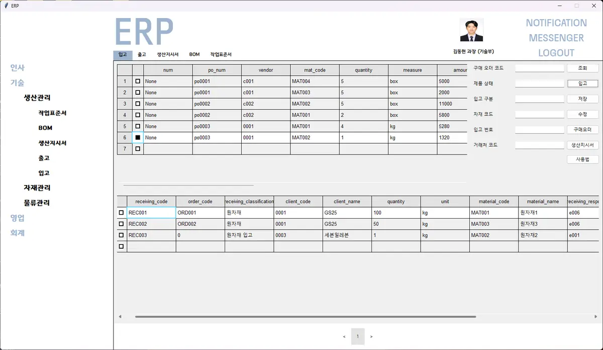
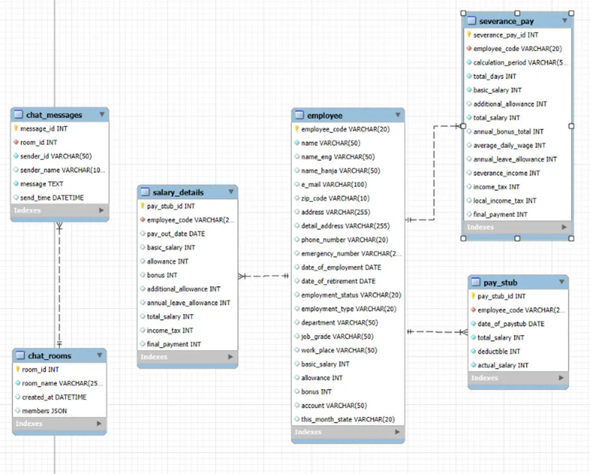
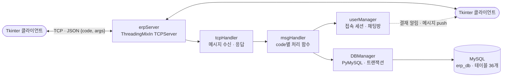

<div align="center">

# 🏭 ERP mini Project

### 인사 · 생산 · 영업 · 회계를 하나로 잇는 데스크톱 ERP

부서마다 따로 관리하던 업무를 **하나의 데이터베이스와 TCP 서버**로 연결하고,<br>
결재 요청과 메시지가 **여러 사용자에게 실시간으로 전달**되도록 만든 사내 ERP 프로그램입니다.

<br>


**교육과정 팀 프로젝트 · 11명 · 2025.02 ~ 2025.03**

</div>

<br>

## 📌 목차

1. [프로젝트 소개](#-프로젝트-소개)
2. [화면](#-화면)
3. [주요 기능](#-주요-기능)
4. [시스템 구조](#-시스템-구조)
5. [내가 맡은 부분](#-내가-맡은-부분)
6. [기술 스택](#-기술-스택)
7. [폴더 구조](#-폴더-구조)
8. [실행 방법](#-실행-방법)
9. [배운 점](#-배운-점)

<br>

## 🌱 프로젝트 소개

기업에서는 생산지시, 자재 입출고, 결재, 회계가 서로 이어져 있지만 부서마다 다른 문서와 프로그램으로 관리되는 경우가 많습니다.
이 프로젝트는 그 흐름을 프로그램으로 다시 구성해 보는 것을 목표로 했습니다.

- 🏢 **4개 부서 업무**(인사 · 기술 · 영업 · 회계)를 하나의 클라이언트에서 메뉴로 이동하며 처리
- 🗄️ 모든 데이터는 **MySQL 한 곳**에 저장하고, 클라이언트는 DB에 직접 접속하지 않고 **서버를 거쳐** 요청
- 🔔 결재 요청 · 승인 · 반려와 메시지는 서버가 **받는 사람의 접속 세션으로 바로 전송**

이 저장소는 팀원들의 작업을 합친 **최종 통합본**입니다.

<br>

## 🖥 화면

| 메인 대시보드 · 결재 알림 | 메신저 패널 |
|---|---|
|  |  |
| **입고: 생산지시서 기준 조회** | **입고: 구매 오더 자재 조회** |
|  |  |

<p align="center"><br><sub>데이터베이스 테이블 관계 일부 (사원 · 급여 · 채팅)</sub></p>

<br>

## ✨ 주요 기능

| 부서 | 메뉴 |
|---|---|
| **인사** | 사원관리, 초과근무 · 연차관리, 급여명세서, 퇴직금명세서 |
| **기술** | 생산관리(작업표준서 · BOM · 생산지시서 · **입고** · **출고**), 자재관리(자재조회 · 구매요청서), 물류관리(창고 등록 · 창고별 자재 조회) |
| **영업** | 거래처 등록 · 관리, 거래내역 조회, 발주서 관리, 판매 실적 조회 |
| **회계** | 전표, 세금계산서, 계정관리, 재무상태표, 손익계산서, 생산 원가 분석 |
| **공통** | 로그인, 대시보드(matplotlib 차트 · 공공데이터 지역별 가스 · 수도 · 전기 사용량), 1:1 · 단체 채팅, 결재 요청 · 승인 · 반려 알림 |

<br>

## 🏗 시스템 구조



**통신 형식**: 메시지마다 앞의 16바이트에 길이를 적고, 그 뒤에 `{"code": 20803, "args": {...}}` 형태의 JSON을 보냅니다.
길이만큼 끝까지 받은 뒤 해석하기 때문에 큰 응답도 잘리지 않습니다.

**요청 분기**: `MsgHandler.process()`가 `code`에 맞는 `f<code>` 함수를 찾아 실행합니다(약 145개).
코드 앞자리로 부서와 처리 방식을 나눴습니다.

| 코드 | 담당 | 예 |
|:---:|---|---|
| `1xxxx` | 인사 | 사원 · 근태 · 급여 |
| `2xxxx` | 기술 | 생산지시 · BOM · 자재 · 창고 · 입고(`208xx`) · 출고(`207xx`) |
| `3xxxx` | 영업 | 거래처 · 발주서 · 판매 실적 |
| `4xxxx` | 회계 | 전표 · 재무제표 · 원가 분석 |
| `7xxxx` | 실시간 전달 | 결재 알림 · 채팅 메시지를 받는 사람의 세션으로 push |
| `8xxxx` | 세션 | 로그인(`81001`) · 로그아웃(`81002`) · 알림 조회/삭제 |

**세션 관리**: `UserManager`가 로그인한 사원과 소켓, 채팅방을 기억하고 있다가, 결재나 메시지가 오면 받는 사람의 소켓으로 바로 보냅니다.

<br>

## 🙋 내가 맡은 부분

**김동현 · 기술부 입고 · 출고 · 알림 담당**

| 모듈 | 클라이언트 | 서버 |
|---|---|---|
| 입고 | `frames/receiving.py` | `msgHandler.f20801 ~ f20816` |
| 출고 | `frames/shipping.py` | `msgHandler.f20701 ~ f20711` |
| 알림 | `frames/notification.py` | `msgHandler.f81007`(삭제) · `f81008`(쌓인 알림 조회) |

**입고**
- 구매 오더 코드 · 자재 코드 · 생산지시서 기준으로 입고 대상을 조회
- 구매 오더의 자재를 입고 테이블로 옮겨 저장 · 수정하고, 입고 창고(plant) 코드를 함께 갱신
- 저장은 트랜잭션으로 처리해 중간에 실패하면 반영되지 않도록 구성

**출고**
- 생산지시서를 기준으로 출고 대상을 조회하고 자재 테이블과 연결
- 공급가액을 기준으로 **부가세(10%)와 총액을 자동 계산**
- 저장 · 수정은 입고와 같은 방식(트랜잭션)으로 처리

**알림**
- 결재 요청 · 완료 · 반려 알림을 화면 오른쪽 위에 실시간으로 표시하고, 개수 배지로 확인하지 않은 알림을 표시
- 로그인할 때 쌓여 있던 알림을 불러오고, 확인한 알림은 서버에서 삭제

<br>

## 🛠 기술 스택

| 구분 | 기술 |
|---|---|
| **Client** | Python, Tkinter, tkcalendar, matplotlib, Pillow |
| **Server** | Python `socketserver` (ThreadingMixIn TCPServer), JSON 메시지 |
| **Database** | MySQL 8.0, PyMySQL |
| **External API** | 공공데이터포털 지역별 가스 · 수도 · 전기 사용량 (`requests`, `python-dotenv`) |
| **Tools** | PyCharm, MySQL Workbench, GitHub |

<br>

## 📁 폴더 구조

```
ERP_Project
├── main.py             # 클라이언트 시작점: 로그인, 메뉴, 화면 전환, 서버 송수신
├── naviframe.py        # 왼쪽 부서 메뉴
├── tablewidget.py      # 표 형태 입력 · 조회 위젯
├── color.py, line.py   # 공통 색상 · 구분선
├── frames/             # 업무 화면 (부서별 프레임)
│   ├── receiving.py    #   입고
│   ├── shipping.py     #   출고
│   ├── notification.py #   알림
│   └── ...             #   인사 · 생산 · 영업 · 회계 화면
├── server/
│   ├── erpServer.py    # TCP 서버 시작점
│   ├── tcpHandler.py   # 길이 헤더 + JSON 수신 · 응답
│   ├── msgHandler.py   # code별 처리 함수 (f<code>)
│   ├── userManager.py  # 접속 사용자 · 채팅방 · push
│   ├── dbManager.py    # MySQL 연결 · 쿼리 · 트랜잭션
│   └── usage.py        # 공공데이터 에너지 사용량 API
├── images/             # 아이콘 · 로고
├── docs/images/        # README 화면 캡처
├── init.sql            # 데이터베이스(erp_db) 생성 스크립트
└── requirements.txt
```

<br>

## 🚀 실행 방법

> **필요 환경**: Python 3.13, MySQL Server 8.0

### 1. 데이터베이스

MySQL Workbench에서 `init.sql`을 실행하면 `erp_db`와 테이블이 만들어집니다.
기존 `erp_db`가 있으면 데이터가 지워지니 먼저 백업하세요.

### 2. 패키지 설치

```bash
pip install -r requirements.txt
```

`패키지 설치.bat`을 실행해도 됩니다.

### 3. 접속 정보 설정

시연 당시 강의실 서버 주소가 코드에 들어 있습니다. 내 PC에서 실행하려면 아래를 바꿔 주세요.

| 파일 | 바꿀 곳 |
|---|---|
| `server/erpServer.py` | `HOST = "192.168.0.29"` → `"localhost"` (포트 `12345`) |
| `main.py` | `run()`의 `connect(("192.168.0.29", 12345))` → `("localhost", 12345)` |
| `server/msgHandler.py` | `DBManager('localhost', 'root', '0000', 3306)` → 내 MySQL 계정 |

대시보드의 에너지 사용량 차트를 쓰려면 `server/.env`에 공공데이터포털 정보를 넣습니다.

```
endpoint=<API 주소>
de_key=<디코딩된 인증키>
```

### 4. 실행

```bash
# 서버
python server/erpServer.py     # 또는 run_server.bat

# 클라이언트 (여러 개 띄워 다른 사원으로 접속하면 알림 · 채팅을 확인할 수 있습니다)
python main.py                 # 또는 run_client.bat
```

> `_tkinter.TclError: Can't find a usable init.tcl` 오류가 나면, Python 설치 경로의 `tcl` 폴더 안 `tcl8.x`, `tk8.x` 폴더를 Python 설치 경로의 `Lib` 폴더에 복사하세요.

<br>

## 💭 배운 점

- 입출고와 알림을 만들면서 단순 CRUD를 넘어 **트랜잭션 제어, 사용자 세션 관리, 요청 코드 분기, 다단계 결재 흐름**을 직접 다뤘습니다.
- 11명이 한 서버와 한 DB를 함께 쓰다 보니, **코드 범위를 부서별로 나누고 테이블 변경 내역을 공유하는 규칙**이 기능만큼 중요하다는 것을 배웠습니다.
- 실시간 알림을 위해 요청-응답과 별도로 **서버가 먼저 보내는(push) 메시지**를 처리하는 소켓 구조를 경험했습니다.

**다시 만든다면**
- 접속 정보(서버 주소 · DB 계정)를 코드가 아닌 설정 파일로 분리
- 일부 쿼리에 값을 문자열로 끼워 넣는 부분을 모두 파라미터 바인딩으로 바꾸기
